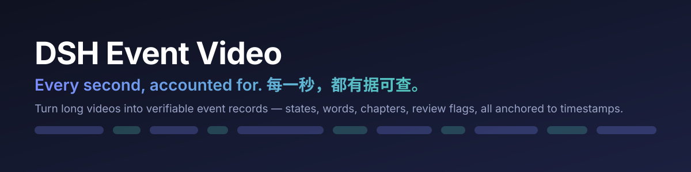
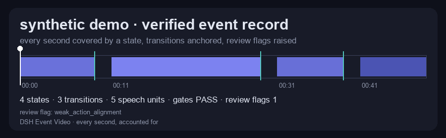

# DSH Event Video



**每一秒，都有据可查。**

把一小时的录屏变成**可验证的事件记录**：画面状态、语音语元、语义章节、注意力，以及确定性的审阅标记——全部锚定到时间戳。

[](LICENSE)
[](engine/pyproject.toml)
[](bundle/package.json)
[](https://github.com/xinghuobk/dsh-event-video/actions)

*[English README](README.md)*



*50 秒合成评审的引擎产物：状态（蓝）、转移（青）、时间尺、校验与审阅标记，直接由真实 vent.json 渲染。*

## 为什么做这个

一场 55 分钟的设计评审里有几百个决定，但模型看不了视频；"抽几帧关键画面"又会悄悄漏掉细节——原话、当时打开的是哪个页面、哪一刻发生了变化，全都丢了。

这个项目不把视频当"图片流"，而是当**事件流**：

- 画面状态 + 状态转移**连续覆盖**整条时间线，不跳段；
- 语音切成带时间戳的语元，并和"画面变化"对齐；
- 章节按页面切换与话题转折切分，而不是固定时间窗；
- 每次构建都自带**确定性审阅块**，点名需要人工复核的地方。

产物是一份智能体能推理的 JSON 事件记录，外加一个"边看边核对"的审阅工作台。

## 产物

```
event.json
├─ states[]        126 个画面状态：时间、语音标签、OCR 标签、URL、注意力
├─ transitions[]   125 次状态转移
├─ units[]         380 条与转移对齐的语音语元
├─ chapters[]      21 个语义章节（页面切换/话题转折、停留、注意力）
├─ gaps[]          ≥3 秒的语音缺口，缺失叙述可见
├─ gates           分区/标签/缺口/语元/章节 校验
└─ review          审阅标记：OCR URL 异常、无标签状态、弱对齐、长度异常
```

## 工作原理

```text
ffmpeg 抽帧 ──► pHash 状态机 ──► 画面状态 + 转移
      │                 │
      │                 ├──► 代表帧 OCR ──► 页面标签
      │                 ├──► 状态起点高分辨率 OCR ──► URL / 标签页提示
      │                 └──► 语音（转写或本地 ASR）──► 语元
      │
      └──► 对齐：哪些话在描述哪次变化（滞后统计）
                         │
                         ├──► 章节：页面切换 + 话题低谷
                         ├──► 注意力：停留 + 指代/动作语言 + 微交互
                         └──► 审阅：确定性自检标记
```

## 试试 50 秒 demo

```bash
cd engine
pip install -e ".[dev,office]"
cd ..
python examples/demo/make_demo.py
event-build examples/demo/demo.mp4 --out examples/demo/out --transcript examples/demo/transcript.txt
```

预期：4 个状态、3 次转移、校验 PASS、1 条审阅标记（章节 49 秒）。

## 仓库结构

| 目录 | 说明 |
|---|---|
| `engine/` | Python 包 `event-build`：流水线与测试 |
| `plugin/` | DSH 工具插件，注册 `build_video_event` |
| `bundle/` | DSH Web 插件：侧栏唯一入口「视频审阅」，含 审阅/总览/库/摄像头 四个标签 |
| `camera/` | 反射式摄像头监控（本地 5Hz 感知，事件才唤醒模型） |
| `scripts/` | 独立使用的库索引脚本 |
| `docs/architecture.md` | 数据模型与流水线细节 |

## 模型（可选，一条命令）

核心只需要 **ffmpeg + Python**；摄像头信号、本地 VLM 描述、本地 ASR 都是可选层：

```bash
python scripts/setup_models.py              # MediaPipe 手/脸/姿态模型（约 17 MB）
python scripts/setup_models.py --with-vlm   # + Ollama 视觉模型（qwen2.5vl:3b，约 3.2 GB）
```

Windows 封装：`powershell -ExecutionPolicy Bypass -File scripts/install.ps1 -WithVlm`。

完整表格（大小、用途、存放位置、关闭方式）与许可证说明：[docs/MODELS.zh.md](docs/MODELS.zh.md)。视觉分层设计（OCR / 几何 / 批量 VLM / 关键帧思考 / GUI 定位）与模型评测方式：[docs/VISION.md](docs/VISION.md)。受限内存下的多模型任务编排（单元任务、模型换入换出、缓存、断点）：[docs/ORCHESTRATION.md](docs/ORCHESTRATION.md)。模型权重不进仓库，按需下载。
## 快速开始（只用引擎）

需要 Python 3.10+ 与 PATH 上的 `ffmpeg`。

```bash
cd engine
python -m venv .venv
source .venv/bin/activate          # Windows: .venv\Scripts\activate
pip install -e ".[dev,office]"

event-build input.mp4 --out out --transcript transcript.txt
```

转写文件每行一句 `[mm:ss] 文本`；也可以本地转写：

```bash
pip install -e ".[asr,dev]"
event-build input.mp4 --out out --asr --whisper-model /path/to/whisper-large-v3
```

得到 `out/event.json`、`out/report.md`（校验 + 审阅标记）、`out/coverage.json`。

## 接入 DSH

**1. 安装工具插件**

```bash
cd "$DSH_PROFILE_DIR"
npm install --install-links --legacy-peer-deps "file:/path/to/dsh-event-video/plugin"
```

在 profile 的 `cordis.patch.yml` 追加（**必须写在 `insert` 里，且用相对路径**——裸包名从 DSH 安装目录解析，profile 里的包不会被看到）：

```yaml
- insert:
    - id: event-video
      name: ./node_modules/dsh-event-video/lib/index.js
      config:
        pythonPath: /path/to/engine/.venv/bin/python
        modelPath: /path/to/whisper-large-v3
        defaultOutDir: /path/to/data/video-events
```

**2. 安装界面插件**

用 DSH 的 plugin manager `install_bundle`，target 指向 `bundle/` 目录；重启 DSH。

**3. 使用**

- 模型工具：`build_video_event(video, transcript | asr, mode?, hi_labels?)` → `review_video_event(out)` → 汇报审阅标记；
- 关键帧思考：`describe_video_frames(out, keyFrames=true, think=true)` 只取章节起点/标注点/注意力最高帧，用推理模型（`vlmThinkModel`，默认 `qwen3-vl:8b`）+ 更大预算生成结论式描述；播放器有 **关键帧思考** 按钮。本地算力，不花 API token。
- 语音：`speak_text(text)` 本地发声（默认 Windows SAPI，也可配 `ttsCommand` 或 OpenAI 兼容 `ttsEndpoint`）；`camera_voice_react(kinds, timeoutS, template)` 等待摄像头事件后一句话回应（模板支持 `{kind}`/`{time}`/`{gesture}`/`{smile}`）。
- VLM 画面描述：`describe_video_frames(out, limit?)` 抽样状态帧，调用配置的 VLM（Ollama `/api/chat` 或 OpenAI 兼容，`vlmEndpoint`/`vlmModel`）生成事实描述，写入 `vision.json`。
- 行动项交付：`export_work_items(out, kind)` 生成 tickets.md/csv/json（来源：标注 + 审阅标记，逐条带时间/帧/验收）或按章节生成 SOP；播放器有 **工单** / **SOP** 按钮。
- 时间轴标注：`annotate_video_record(out, t0, text)` / `list_video_annotations(out)` 写入带帧锚点的 `annotations.json`（不改 event.json）；播放器有「标注」按钮和标注列表。
- 跨库检索：`search_video_library(query)` 返回带时间戳/帧/原话的排序结果；`ask_video_library(question)` 返回证据包并附带引用规范。「汇总」页可搜。
- 元素定位：`ground_ui_element(out, t, instruction)` 调用 UI-TARS-7B（llama.cpp）返回目标元素的像素坐标，按帧+指令缓存，返回 `{point, raw, frame}`。
- 精确文字：`ocr_video_frame(out, t)` 调用配置的 OCR 命令（优先 PaddleOCR-VL，回退经典 PaddleOCR），按帧缓存，返回 `{engine,text,lines,frame}`；URL/小字以它为准，不要用 VLM 描述。
- 证据融合：`fuse_vision_evidence(out, t, instruction, samples?)` 用 OCR 文本框校验 UI-TARS 定位点，可传 3 次指令改写做坐标共识，并检测 VLM 描述与 OCR 文本的矛盾；返回校准置信度、冲突和分专家证据。
- 融合工单：`fuse_to_work_item(out, t, instruction, samples?, title?)` 把融合结果直接生成一张工单（元素、框、点、置信度、冲突、验收标准），输出到 `exports/`。
- 批量调度：`run_vision_batch(records, instructions, samples?, times?, describe?, think?)` 最多 20 条记录排队串行跑流水线，逐条记录状态，批次文件写到 `<数据目录>/batches/`；单条失败不影响后续（`GET /event-video/batch-progress?id=`）。`n- 流水线工具：`run_vision_pipeline(out, instructions, samples?, times?, describe?, think?)` 一次跑完描述/关键帧思考/融合工单（默认取注意力最高帧+章节起点），写 `pipeline.json`。
- 看帧：`read_video_frame(out, t)` 返回该时间点的帧路径 + 画面标签/章节/邻近原话，模型再对路径调用 `read_image` 真正看图（播放器里的 **看帧** 按钮同源）。
- 导出：`export_video_analysis(out)` 生成 `analysis.md`、`chapters.csv`、`analysis.docx`、`analysis.xlsx` 和原始 `event.json`（写到数据目录 `exports/`）；`summarize_video_analyses()` 一次性返回所有记录的总览（总量、审阅标记分布、跨记录注意力最高段落）；
- 界面：侧栏「视频审阅」→ 审阅（播放器 + 同步转写）、总览（Gantt + 章节）、库（缩略图、搜索、标签、对比、队列、回收站）、汇总（所有分析一屏总览 + 一键导出）、摄像头。

## 摄像头（Windows，显式开启）

```bash
pip install -r camera/requirements.txt
# 首次：下载 MediaPipe 手/脸模型（约 11MB）到数据目录
python camera/download_models.py
python camera/camera-monitor.py --device "video=Your Camera"
```

监控还会加载本地 MediaPipe 模型（`hand_landmarker.task`、`face_landmarker.task`），产出 **手势/挥手/微笑/皱眉/人脸出现/离开** 事件，并支持个人中性基线校准（`camera_calibrate`）与阈值反馈（`camera_feedback`）。bundle 注册：`camera_state`（即时结构化状态）、`camera_wait`（阻塞等待运动/画面/主体事件）、`camera_snapshot`（抓帧路径，配合 `read_image`）。只有用户显式开启才采集，画面留在本地。面板预览走本地 MJPEG 流（`/camera/stream`）；采集 640x480@15fps（分析降到 320x240），`latest.jpg` 每帧刷新。新增身体动作事件：`both_hands_up` / `arms_crossed` / `hands_on_hips`（`pose_action`）。

## 配置

| 环境变量 / bundle 配置 | 含义 |
|---|---|
| `DSH_EVENT_VIDEO_HOME` / `dataHome` | 数据根目录（记录、缓存、摄像头），默认 `~/event-video` |
| `DSH_EVENT_VIDEO_PYTHON` / `pythonPath` | 装了 `event-build` 的解释器 |
| `DSH_EVENT_VIDEO_WHISPER` / `whisperModel` | 本地 faster-whisper 模型目录 |
| `DSH_EVENT_VIDEO_CAMERA_DEVICE` / `cameraDevice` | ffmpeg dshow 设备 |
| `DSH_EVENT_VIDEO_ROOTS` / `extraRoots` | 额外允许的媒体根目录（`;` 分隔） |
| `DSH_EVENT_VIDEO_VLM_ENDPOINT` / `vlmEndpoint` | Ollama `/api/chat` 或 OpenAI 兼容 URL |
| `DSH_EVENT_VIDEO_VLM_MODEL` / `vlmModel` | VLM 模型名（如 qwen2.5vl） |
| `DSH_EVENT_VIDEO_MEDIAPIPE_DIR` / `mediapipeDir` | 手/脸 `.task` 模型目录（默认 `<home>/models/mediapipe`） |
| `DSH_EVENT_VIDEO_CAMERA_SIGNALS` / `enableCameraSignals` | `0`/false 关闭手势与表情事件 |
| `DSH_EVENT_VIDEO_CAMERA_SIZE` | 采集分辨率，默认 `640x480` |
| `DSH_EVENT_VIDEO_VOICE` / `enableVoice` | `0`/false 关闭语音与语音反应 |
| `DSH_EVENT_VIDEO_TTS_COMMAND` / `ttsCommand`（+`ttsArgs`）/ `ttsEndpoint` | 本地 TTS 可执行文件或 OpenAI 兼容语音 URL |

## 审阅标记

`review` 是确定性的，每次构建都会跑，不额外调用模型。它会标记：

- 完整性校验未通过；
- OCR 把 URL 里的 `=` / `&` 读丢（地址栏识别真实存在的失败模式）；
- 完全没有标签的状态；
- ≥60 秒的语音缺口；
- 动作对齐弱、语音滞后过大；
- 章节短于 30 秒或长于 300 秒。

构建工具的摘要会带上同一块内容，模型可以在同一轮回答里汇报。

## 已知限制

- 只支持 mp4；章节边界是字符 bigram 启发式（粗但稳定）。
- 注意力是排序代理，不是校准过的概率。
- 摄像头采集仅限 Windows/DirectShow。
- 构建队列在内存中：重启 DSH 会丢队列（记录仍在磁盘）。
- OCR 可能读错 URL 标点；审阅会标记，但不会自动纠正。

## 参与贡献

见 [CONTRIBUTING.md](CONTRIBUTING.md)。提交 PR 前跑 `pytest -q engine/tests` 和 Node 语法检查。

## License

MIT © 2026 xinghuobk
